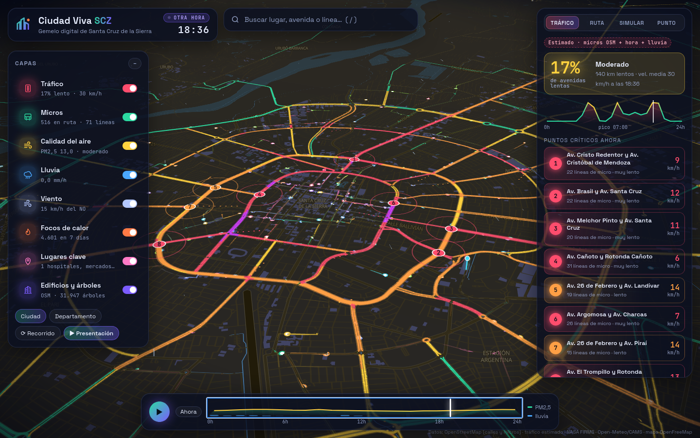

<p align="center"><a href="https://neckhurtttt.github.io/ciudad-viva/"></a></p>

<p align="center"><b><a href="https://neckhurtttt.github.io/ciudad-viva/">▶ Abrir Ciudad Viva</a></b></p>

**Ciudad Viva SCZ** es un gemelo digital de Santa Cruz de la Sierra en 3D, en el navegador: tráfico, micros, rutas, calidad del aire, lluvia y focos de calor en un solo mapa.



## Qué hace

| | |
|---|---|
| **Tráfico** | Cada tramo de avenida (2.177) se pinta por velocidad estimada. Ranking de los 8 cruces más críticos con su nombre y curva de las 24 horas. |
| **Ruta A→B en auto** | Camino más rápido por avenidas según el tráfico de la hora y **a qué hora conviene salir** (próximas 12 h). |
| **Ir desde donde estás** | Botón ➜ en cada resultado del buscador o "◎ Desde mi ubicación": usa el GPS como origen. |
| **Guiarme** | Navegación paso a paso (GPS): gira a la derecha/izquierda en tal avenida, camina a la parada, toma la línea X y baja en Y; distancia, minutos y hora de llegada; la cámara te sigue y recalcula si te desvías; voz opcional. **Simular el viaje** lo recorre solo (para probar o presentar). |
| **Líneas** | Pestaña con las 71 líneas: busca por número, barrio o lugar ("UPSA" → las que pasan a menos de 300 m) y mira su recorrido, largo, calles y lugares por donde pasa. |
| **Ruta en micro** | Qué línea tomar, dónde bajar y cuánto caminar, directo o con un transbordo, con las 71 líneas. |
| **Simular** | Escenarios listos (desfile en el centro, bloqueo del 4to anillo, obras en el Cristo Redentor, aguacero a la salida) o cierra avenidas a mano: el tráfico se desvía y se compara la zona antes y después con un titular. |
| **Reportes** | Choque, bloqueo, calle inundada o bache: aparece en el mapa, frena el tráfico cercano 3 horas y otros lo confirman tocándolo. |
| **Compartir** | Un enlace guarda la cámara, la hora, la ruta, el escenario y las capas para mandarlo por WhatsApp. |
| **Buscador** | Lugares, avenidas y líneas de micro (tecla `/`). Cada resultado puede ser origen o destino. |
| **Tu punto** | Tocas el mapa: aire (PM2,5), lluvia, viento, micros que pasan a 400 m, foco de calor más cercano y mejor hora para salir. |
| **3D** | Día y noche según la hora (cielo, sol, ventanas y faroles), lluvia que cae donde llueve, humo de los focos movido por el viento real, edificios con ventanas, ~30 mil árboles y ~200 lugares clave con haz de luz. |
| **Celular** | Panel deslizable desde abajo y calidad automática: si van menos de 26 cuadros/s baja árboles y partículas. |
| **Presentación** | Recorrido guiado de 7 pasos para mostrarlo sin tocar nada, con **narración por voz** opcional (botón 🔈 Voz). |
| **Kiosco** | Pantalla completa con la presentación en bucle para un stand (botón ▣ Kiosco o abrir con `#kiosco`). Esc para salir. |
| **Alertas** | Pestaña nueva: aire de hoy y mañana, lluvia de mañana, focos a menos de 10 y 50 km (y si el viento trae humo), atasco de entrada 7:45 y salida 18:45, y tu ruta. Con tu ubicación usa tu avenida. **Notificaciones** del navegador para lo grave y **canal diario por Telegram**. |
| **Zonas** | Capa de zonas por anillo (norte/este/sur/oeste) con % de avenidas lentas, velocidad, aire, líneas de micro y focos; ranking en el panel de tráfico. |
| **Fuego en contexto** | 25 años de focos del departamento (2001–2025, MODIS + VIIRS armonizados por NINAWI) y si esta semana está por encima de lo normal. |
| **Comparar** | En Simular, el mapa alterna ANTES / DESPUÉS del cierre o la lluvia; el titular dice cuántos minutos suma cruzar la zona. |
| **Captura** | Imagen de la vista con hora, % de tráfico lento, PM2,5, focos y el titular de la simulación, lista para compartir. |
| **Cómo calculamos** | Cada capa y alerta lleva su etiqueta EN VIVO, RESPALDO, SATÉLITE, OSM, SIMULADO o ESTIMADO, y una ventana explica el modelo. |
| **Edificios icónicos** | Las 11 torres más altas terminadas + Macororó 16/17 (en construcción) con su planta real de OpenStreetMap y su altura publicada (Green Tower 140 m, Platinum II 136 m, La Casona 127 m…), con nombre, altura y pisos; buscables. La Catedral con su planta de OSM y dos torres en la fachada que da a la plaza (altura estimada: no hay medida publicada). |
| **Todas las casas** | ~484 mil edificios de Microsoft Global ML Building Footprints (IA sobre imágenes satelitales) completan los que faltan en OpenStreetMap; cada techo con su color y borde verde neón. Se bajan con `python scripts/casas_ms.py` y se cargan por zonas de 2 km. |
| **Daltónicos** | El tráfico pasa de verde/rojo a azul/naranja. |

## Qué es en vivo y qué es estimado

- **En vivo:** clima de Open-Meteo (PM2,5, lluvia, viento, temperatura) hora por hora del día.
- **Estimado:** el tráfico. No hay datos abiertos de tráfico en vivo para Bolivia (TomTom, HERE y Google no cubren Santa Cruz), así que se calcula por tramo con datos reales: cuántas líneas de micro pasan (OSM), tipo de vía, horas pico, cercanía al centro y lluvia, con una curva velocidad-volumen tipo BPR.
- **Simulado:** la posición de los micros (las rutas son reales).
- **Satelital:** focos de calor VIIRS de NASA FIRMS de los últimos 7 días, actualizados cada mañana por una GitHub Action.
- **Histórico:** 25 años de focos (NINAWI, `datos/historico.json`).
- **Zonas:** anillos aproximados; OpenStreetMap no tiene los distritos municipales de Santa Cruz.
- **Reportes:** se guardan en el navegador. Con un `config.js` que defina `window.CV_SUPABASE = { url, key }` (tabla `reportes`: id, tipo, lon, lat, creado, votos) se comparten entre todos.

## Datos

OpenStreetMap (avenidas, cruces y 71 líneas de micro) · OpenFreeMap (mapa base, lugares y parques) · Open-Meteo y CAMS (clima y aire) · NASA FIRMS (focos de calor) · NINAWI (25 años de focos MODIS+VIIRS) · Microsoft Global ML Building Footprints (casas, ODbL) · geoBoundaries (límite departamental).

## Alertas por Telegram

La Action diaria (`.github/workflows/focos.yml`, 7:17 de Bolivia) baja los focos y luego corre `scripts/alertas.py`, que manda un resumen (aire de hoy y mañana, lluvia, focos cerca de la ciudad y horas pico) a un canal o grupo de Telegram:

1. Crear un bot con @BotFather y copiar su token.
2. Agregar el bot como administrador del canal (o al grupo).
3. En GitHub → Settings → Secrets → Actions: `TELEGRAM_TOKEN` (el token) y `TELEGRAM_CHAT` (por ejemplo `@ciudadvivascz` o el id del grupo).
4. Opcional: en `config.js`, `window.CV_TELEGRAM = "https://t.me/ciudadvivascz"` para que el botón de la app abra el canal.

Sin esos secretos el script solo imprime el mensaje (sirve para probarlo: `python scripts/alertas.py`).

## Correr en local

```bash
python -m http.server 8765
# abrir http://localhost:8765
```

Para regenerar los datos: `python scripts/preparar.py` (necesita los proyectos MicroSCZ y calendario-fuego al lado).

Hecho con MapLibre GL 4 y deck.gl 9, sin frameworks ni build.
