<p align="center"><a href="https://neckhurtttt.github.io/ciudad-viva/"></a></p>

<p align="center"><b><a href="https://neckhurtttt.github.io/ciudad-viva/">▶ Abrir Ciudad Viva</a></b></p>

**Ciudad Viva SCZ** es un gemelo digital de Santa Cruz de la Sierra en 3D, en el navegador: tráfico, micros, rutas, calidad del aire, lluvia y focos de calor en un solo mapa.


## Qué hace

| | |
|---|---|
| **Tráfico** | Cada tramo de avenida (2.177) se pinta por velocidad estimada. Ranking de los 8 cruces más críticos con su nombre y curva de las 24 horas. |
| **Ruta A→B** | Camino más rápido por avenidas según el tráfico de la hora y **a qué hora conviene salir** (próximas 12 h). |
| **Simular** | Cierra una avenida (bloqueo, obra, desfile) o activa una lluvia fuerte: el tráfico se desvía y se compara la zona antes y después. |
| **Buscador** | Lugares, avenidas y líneas de micro (tecla `/`). Cada resultado puede ser origen o destino. |
| **Tu punto** | Tocas el mapa: aire (PM2,5), lluvia, viento, micros que pasan a 400 m, foco de calor más cercano y mejor hora para salir. |
| **3D** | Edificios con ventanas encendidas, ~30 mil árboles en parques, ~200 lugares clave con haz de luz, cielo y niebla. |
| **Presentación** | Recorrido guiado de 7 pasos para mostrarlo sin tocar nada. |

## Qué es en vivo y qué es estimado

- **En vivo:** clima de Open-Meteo (PM2,5, lluvia, viento, temperatura) hora por hora del día.
- **Estimado:** el tráfico. No hay datos abiertos de tráfico en vivo para Bolivia (TomTom, HERE y Google no cubren Santa Cruz), así que se calcula por tramo con datos reales: cuántas líneas de micro pasan (OSM), tipo de vía, horas pico, cercanía al centro y lluvia, con una curva velocidad-volumen tipo BPR.
- **Simulado:** la posición de los micros (las rutas son reales).
- **Satelital:** focos de calor VIIRS de NASA FIRMS de los últimos 7 días.

## Datos

OpenStreetMap (avenidas, cruces y 71 líneas de micro) · OpenFreeMap (mapa base, lugares y parques) · Open-Meteo y CAMS (clima y aire) · NASA FIRMS (focos de calor) · geoBoundaries (límite departamental).

## Correr en local

```bash
python -m http.server 8765
# abrir http://localhost:8765
```

Para regenerar los datos: `python scripts/preparar.py` (necesita los proyectos MicroSCZ y calendario-fuego al lado).

Hecho con MapLibre GL 4 y deck.gl 9, sin frameworks ni build.
